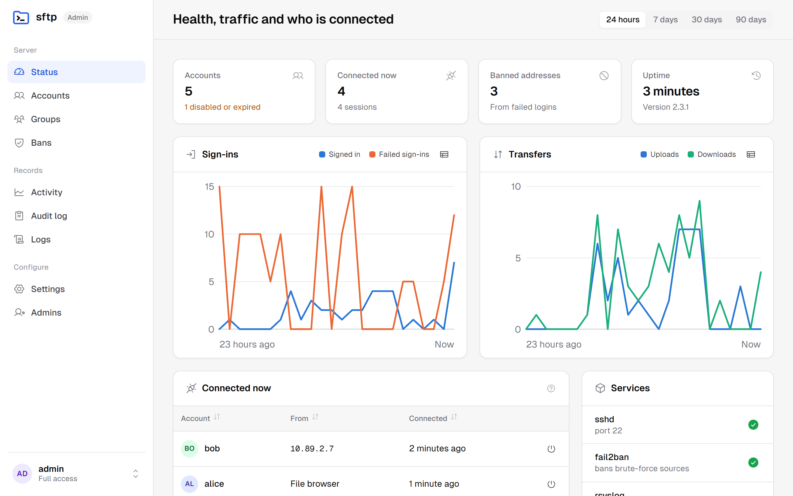

<div align="center">


# SFTP

**A hardened OpenSSH SFTP server in one container, with an optional admin web UI and file browser behind two-factor sign-in.**

[](https://github.com/MarkusMcNugen/docker-sftp/actions/workflows/release.yml)
[](https://hub.docker.com/r/markusmcnugen/sftp)
[](https://github.com/MarkusMcNugen/docker-sftp/blob/main/LICENSE.txt)
[](https://www.debian.org/releases/trixie/)

**[Documentation](https://markusmcnugen.github.io/docker-sftp/)** | [Your First Server](https://markusmcnugen.github.io/docker-sftp/docs/tutorials/first-server/) | [Changelog](https://github.com/MarkusMcNugen/docker-sftp/blob/main/CHANGELOG.md)

Each account is jailed in its home directory, fail2ban bans password guessers, and one `/config` volume holds everything, applied again on every start.

<a href="https://markusmcnugen.github.io/docker-sftp/docs/how-to/use-the-web-ui/">
<picture>
<source media="(prefers-color-scheme: dark)" srcset="https://raw.githubusercontent.com/MarkusMcNugen/docker-sftp/main/.github/dashboard-dark.png">

</picture>
</a>

</div>

---

<details>
<summary><b>Table of contents</b></summary>

- [Features](#features)
- [Quick start](#quick-start)
- [Why this image](#why-this-image)
- [Accounts](#accounts)
- [Settings](#settings)
- [Security](#security)
- [Upgrading from 1.x](#upgrading-from-1x)
- [Repository layout](#repository-layout)
- [Building and testing](#building-and-testing)
- [Platforms](#platforms)
- [Wiki](#wiki)
- [Credits and influences](#credits-and-influences)
- [Use of AI tools](#use-of-ai-tools)
- [License](#license)
- [Contributing](#contributing)

</details>

---

## Features

<details open>
<summary><b>What you get</b></summary>

- [SFTP only](https://markusmcnugen.github.io/docker-sftp/docs/explanation/security-model/), each account jailed in its home folder, with no shells and no forwarding.
- [fail2ban](https://markusmcnugen.github.io/docker-sftp/docs/how-to/tune-fail2ban/) bans password guessers, repeat offenders for longer, and [country rules](https://markusmcnugen.github.io/docker-sftp/docs/how-to/block-countries/) drop whole countries.
- [Sign-ins from unusual places wait for approval](https://markusmcnugen.github.io/docker-sftp/docs/how-to/hold-unusual-sign-ins/), and a password spray locks an account to its own networks.
- An optional [admin web UI](https://markusmcnugen.github.io/docker-sftp/docs/how-to/use-the-web-ui/) for accounts, keys, bans and settings, behind argon2id passwords, two-factor codes and an audit log.
- An optional [file browser](https://markusmcnugen.github.io/docker-sftp/docs/how-to/use-the-file-browser/) where account holders work with their files, behind a web password and two-factor, with their own permissions.
- [Accounts](https://markusmcnugen.github.io/docker-sftp/docs/how-to/add-users/) from a file, an environment variable or a Docker secret, with [permissions](https://markusmcnugen.github.io/docker-sftp/docs/how-to/set-account-permissions/), [groups](https://markusmcnugen.github.io/docker-sftp/docs/how-to/group-accounts/) and [rsync](https://markusmcnugen.github.io/docker-sftp/docs/how-to/allow-rsync/) per account.
- [Changes apply live](https://markusmcnugen.github.io/docker-sftp/docs/how-to/apply-changes-live/), without a restart or dropped sessions.
- Debian 13 and OpenSSH 10 with post-quantum key exchange, rebuilt every week; [ten capabilities](https://markusmcnugen.github.io/docker-sftp/docs/how-to/harden-the-container/) and `no-new-privileges`; amd64 and arm64.

</details>

## Quick start

```bash
mkdir -p /srv/sftp/alice && chown 1001:100 /srv/sftp/alice

docker run -d --name sftp --restart unless-stopped \
  --cap-add NET_ADMIN --cap-add NET_RAW \
  -p 2222:22 \
  -v /srv/sftp/config:/config \
  -v /srv/sftp/alice:/home/alice/upload \
  markusmcnugen/sftp alice:changeme:1001:100
```

```bash
sftp -P 2222 alice@localhost
```

Alice lands in `/` of her jail and can write to `upload`, which is `/srv/sftp/alice` on the host. The first start generates host keys in `/config/sshd/keys` and prints their fingerprints in `docker logs sftp`; compare them with what your client shows on first connect.

[Your First Server](https://markusmcnugen.github.io/docker-sftp/docs/tutorials/first-server/) walks through key logins and fail2ban as well. [`compose.yaml`](https://github.com/MarkusMcNugen/docker-sftp/blob/main/compose.yaml) is a deployment with every hardening option.

## Why this image

Running `sshd` for file transfer alone takes a chroot that sshd will accept, keys that users cannot change, a crypto policy, a jail for brute-force sources and a way to keep accounts in step with a list. This image does all of it from a single account line per user, checks the whole configuration before it listens, and keeps working configuration in `/config` across image updates: settings go in drop-in files that updates never overwrite.

## Accounts

One line per account, in `/config/sshd/users.conf`:

```
name:password[:e][:uid[:gid[:dir1,dir2,...[:options]]]]
```

```text
alice:changeme:1001:100:upload
bob::1002:100:inbox,outbox
carol:$y$j9T$6IoIpga7qoVTKEtg7uOmk.$wqs4plcBkLh9AkLUNTXVh2MqiT4GaFcVqfk.9yQ.N/0:e:1003
```

Bob has no password and logs in with the key in `/config/userkeys/bob.pub`. Carol's password is a hash from `docker run --rm -it markusmcnugen/sftp mkpasswd -m yescrypt`. Options at the end of a line set permissions, rsync, file browser access, groups and limits. The grammar, the options, the other sources of accounts and every rule are in [users.conf](https://markusmcnugen.github.io/docker-sftp/docs/reference/users-conf/).

## Settings

<details>
<summary><b>Environment variables</b></summary>

| Variable | Default | Effect |
|---|---|---|
| `SFTP_USERS` | | Space-separated account lines |
| `SFTP_USERS_FILE` | | A file of account lines, such as a Docker secret |
| `SFTP_PORT` | `22` | Port sshd listens on inside the container |
| `SFTP_LOG_TRANSFERS` | `false` | Log every file operation |
| `SFTP_UMASK` | `022` | Umask for uploaded files, such as `002` for group-writable |
| `SFTP_CRYPTO_POLICY` | `modern` | `strict` accepts encrypt-then-MAC MACs only |
| `SFTP_AUTH_LOG_MAX_BYTES` | `10485760` | Size in B at which the internal auth log rotates; `0` for no cap |
| `SFTP_RSYNC_USERS` | | Accounts allowed rsync over SSH, or `*` for all |
| `FAIL2BAN_ENABLED` | `true` | `false` runs without fail2ban |
| `TZ` | `UTC` | Time zone for log timestamps |
| `WEBUI_ENABLED` | `false` | Runs the admin web UI, on `WEBUI_PORT` (`8443`) |
| `WEBUI_FILES_ENABLED` | `false` | Runs the file browser, on `WEBUI_FILES_PORT` (`8444`) |
| `SFTP_COUNTRY_RULE` | `off` | `block` or `allow` the countries in `SFTP_COUNTRIES` |
| `SFTP_COUNTRIES` | `CN IN BR RU VN` | Two-letter country codes for the rule |

</details>

The web UI's Settings page writes the server settings to `/config/sshd/settings.conf`; a variable set in the environment wins. sshd settings go in `/config/sshd/sshd_config.d/*.conf` and fail2ban settings in `/config/fail2ban/jail.local`. The [Environment Variables](https://markusmcnugen.github.io/docker-sftp/docs/reference/environment-variables/) and [/config Volume](https://markusmcnugen.github.io/docker-sftp/docs/reference/config-volume/) references list every value and path.

## Security

- fail2ban bans by adding firewall rules inside the container's network namespace, which needs `NET_ADMIN` and `NET_RAW`. Without them it detects attacks but cannot block them, and the log says so at start. The country rules need `NET_ADMIN` as well.
- The web UI and the file browser run as unprivileged users and change the server only through a root helper that takes a fixed list of checked requests. The file browser reaches files through SFTP with certificates that last five minutes, so each account's permissions and jail apply there too.
- Bans need the client's real address. Docker's port publishing keeps it; a reverse proxy, a load balancer or Docker's userland proxy replaces it with its own, and one attacker then gets everyone banned.
- The `modern` crypto policy keeps plain `hmac-sha2-256` and `hmac-sha2-512` last in the list of MACs (message authentication codes, which detect tampering) for clients without encrypt-then-MAC, such as paramiko. `SFTP_CRYPTO_POLICY=strict` removes them.
- Anyone who can write `/config` controls the accounts and runs startup scripts as root.

[Security Model](https://markusmcnugen.github.io/docker-sftp/docs/explanation/security-model/) covers each measure and its limits.

## Upgrading from 1.x

Point the image at the existing `/config`. `users.conf`, host keys, user keys and the ban database are read as they are. An untouched 1.x `sshd_config` or `jail.conf` is renamed `*.legacy` and the hardened defaults apply; an edited one is still used, with a warning. Add `NET_ADMIN` and `NET_RAW`. [How To Upgrade From 1.x](https://markusmcnugen.github.io/docker-sftp/docs/how-to/upgrade-from-1x/) lists what to move by hand.

## Repository layout

| Path | Role |
|---|---|
| `Dockerfile` | the image: Debian 13 slim, OpenSSH, fail2ban, rsyslog, tini |
| `rootfs/usr/local/bin/entrypoint` | builds the configuration from `/config` and supervises the services |
| `rootfs/usr/local/bin/healthcheck` | the container health check |
| `rootfs/etc/ssh/sshd_config` | the built-in sshd configuration |
| `rootfs/etc/fail2ban/` | the built-in jail and server settings |
| `rootfs/etc/rsyslog.conf` | log routing to the container log and the auth log |
| `rootfs/usr/local/lib/sftp/legacy-defaults.sha256` | hashes of the 1.x default files, for upgrades |
| `rootfs/usr/local/libexec/sftp/rsync-gate` | the login shell of accounts allowed rsync |
| `webui/` | the admin web UI, the file browser and their root helper, in Rust |
| `tests/run-tests.sh` | the integration suite, with `tests/webui_driver.py` for the web UI |
| `tests/fixtures/legacy-1.x/` | the 1.x default `sshd_config` and `jail.conf` |
| `wiki/` | the Hugo site with the tutorial, how-to guides, explanations and reference |
| `.github/workflows/` | the release build and the wiki deployment |
| `compose.yaml` | a hardened deployment example |
| `CHANGELOG.md` | what changed in each version |

## Building and testing

```bash
docker build -t sftp .
tests/run-tests.sh sftp                     # ENGINE=podman for Podman
SCENARIOS="main options" tests/run-tests.sh sftp
```

The suite starts real servers on a private network and drives them with OpenSSH clients from other containers: password, hash and key logins, the jail, refused shells, forwarding and weak crypto, transfer logs, bans, log rotation, reconciliation across a restart, permissions and groups, the country rules, live apply, the admin web UI and the file browser over HTTPS, the minimal capability set, 1.x migration, and refused configurations. [How To Build And Test The Image](https://markusmcnugen.github.io/docker-sftp/docs/how-to/build-and-test/) describes each scenario.

`.github/workflows/release.yml` runs on a `v*` tag, every week, and by hand. It lints, runs the suite on a native x86 runner and a native arm64 runner, scans with Trivy, and publishes to Docker Hub and GHCR with an SBOM and provenance.

## Platforms

- **Images:** `linux/amd64` and `linux/arm64`, each tested on its own architecture before it is published.
- **Hosts:** the suite passes on Ubuntu 24.04 x86-64 with rootless Podman 4.9.3, apart from transfer logging there, which the host's AppArmor profile for rsyslogd blocks and the image reports at start. Docker gives every container its own AppArmor profile and Unraid has no AppArmor, so neither should block it; the release workflow runs the suite under Docker on both architectures.
- **Clients:** checked against OpenSSH 10, OpenSSH for Windows 9.5 and paramiko 5.0.

## Wiki

The documentation site is at **[markusmcnugen.github.io/docker-sftp](https://markusmcnugen.github.io/docker-sftp/)**, built from [`wiki/`](https://github.com/MarkusMcNugen/docker-sftp/tree/main/wiki) by `.github/workflows/wiki-deploy.yml` on every push to main. It is a Hugo site using the Hextra theme, organized by the Diataxis framework:

- a tutorial that builds a first server, from an empty folder to key logins and a ban;
- nineteen how-to guides: users, hashed passwords, public keys, permissions, groups, shared folders, applying changes live, sshd settings, fail2ban, transfer logs, rsync, hardening, Unraid, upgrading from 1.x, the admin web UI, the file browser, country rules, building and testing, and fixing failures;
- two explanations: how the container works, and the security model;
- six reference pages: environment variables, users.conf, the /config volume, commands, built-in settings, and log messages.

## Credits and influences

- **[atmoz/sftp](https://github.com/atmoz/sftp)**, which this project was forked from, set the account line format that `users.conf` still uses.
- **[OpenSSH](https://www.openssh.com/)** provides the server, the chroot and `internal-sftp`; **[fail2ban](https://github.com/fail2ban/fail2ban)** the bans; **[rsyslog](https://www.rsyslog.com/)** the log routing; **[tini](https://github.com/krallin/tini)** process 1.
- **[ssh-audit](https://github.com/jtesta/ssh-audit)**'s hardening guides shaped the crypto policy.
- [IP Geolocation by DB-IP](https://db-ip.com): the image carries DB-IP's IP to Country Lite database, licensed [CC BY 4.0](https://creativecommons.org/licenses/by/4.0/).
- With a MaxMind key, this product includes GeoLite2 data created by MaxMind, available from [maxmind.com](https://www.maxmind.com).
- The web UI bundles **[htmx](https://htmx.org)** (0BSD), **[Phosphor Icons](https://phosphoricons.com)** (MIT), **[flag-icons](https://github.com/lipis/flag-icons)** (MIT) and the **[Geist](https://vercel.com/font)** fonts (SIL Open Font License 1.1); their licenses are in `webui/assets/licenses/`.
- **[Hextra](https://github.com/imfing/hextra)** is the wiki's theme.

## Use of AI tools

The author used Claude (Anthropic) via the Claude Code CLI for code development assistance, documentation drafting, and test scripting during the preparation of this repository. All design decisions and the final content were determined by the author. The image, the entrypoint and the documentation were verified by the integration suite, shellcheck, hadolint and actionlint, and by logins from real SFTP clients.

## License

MIT, see [LICENSE.txt](https://github.com/MarkusMcNugen/docker-sftp/blob/main/LICENSE.txt).

## Contributing

Issues and pull requests are welcome at [github.com/MarkusMcNugen/docker-sftp](https://github.com/MarkusMcNugen/docker-sftp). A change to the entrypoint comes with a check in `tests/run-tests.sh` that fails without it.
